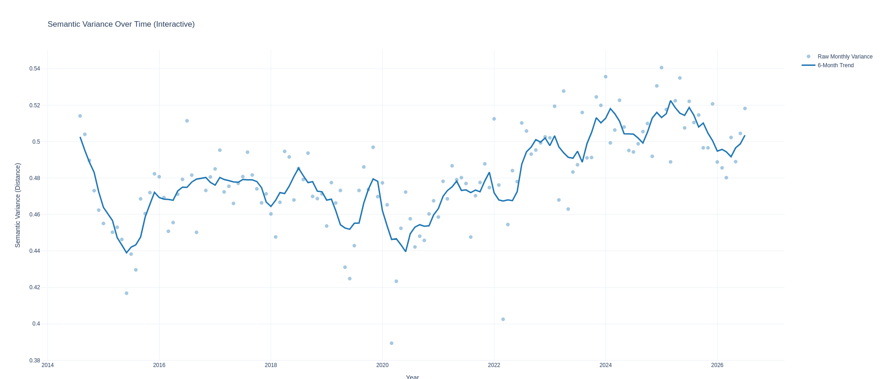
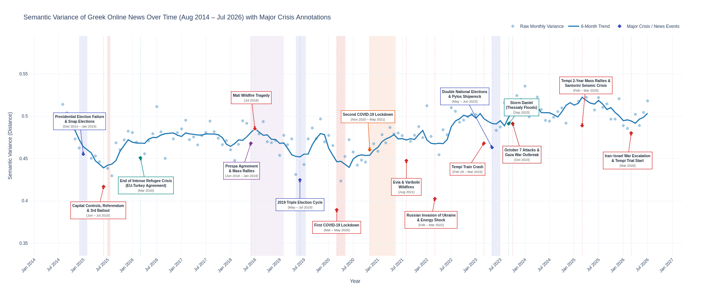

# Semantic-Diversity-Greek-News

## Data Acquisition and First ML Tasks

This project focused on 8 major Greek news outlets. Snapshots of their home pages were downloaded from the wayback machine and then scrapers were designed to extract the 8 most prominent headlines from each snapshot. For each month, 4 snapshots per source were downloaded. The dates selected were such that as many of the sources as possible would be available for the same day (for most of the selected dates all 8 sources were available). Months with insufficient data had to be handled gracefully. Also, a json file of the different snapshots to be downloaded had to be created and updated (for example, when one of the selected snapshots was not available, despite the API showing it as such).

Designing the scrapers and downloading the html snapshots were the most time-consuming parts. For the former, the problem is that each time a news source changed its layout, a new scraper had to be designed. The layout changes were identified in advance using a clustering algorithm on TF-IDF scores on the snapshots' text. The creation of the scrapers was then carried out with a simple human-in-the-loop method. For the latter, the main problem was the lack of reliability of the wayback machine and the occasional silent corruption of downloaded data, which made it necessary to implement checks and reattempt failed downloads.

## Data Processing and Results

During the headline extraction (from the snapshots), it became obvious that some of the headlines were mojibake. A change in the encoding did not fix everything; some parts of the text were genuinely corrupted. Additionally, using a BERT model to fill in the gaps did not work in many cases, as the model did not have sufficient context to infer the missing part. Instead, a dictionary of common headline words was created (out of the corpus of non-corrupt headlines) and incomplete words were expanded to a word from the dictionary. (The advantage of using a dictionary created out of our own data is that it also contains names of political figures, which are not present in a standard Greek language dictionary). Afterwards, BERT was used to fill in any remaining gaps.

Once the extraction was complete, the headlines were turned into embeddings and two metrics (per-month variance and entropy) were calculated. They both behaved similarly, so here we will only display the variance. As you can see, the best way to interpret the variance is as a measure of the events' intensity. If a month has particularly significant events, every source is bound to report them, thus lowering variance. This interpretation is reinforced by observing the two periods with the least variance: they were the first COVID-19 lockdown and the period of the financial crisis and its associated political turmoil.

